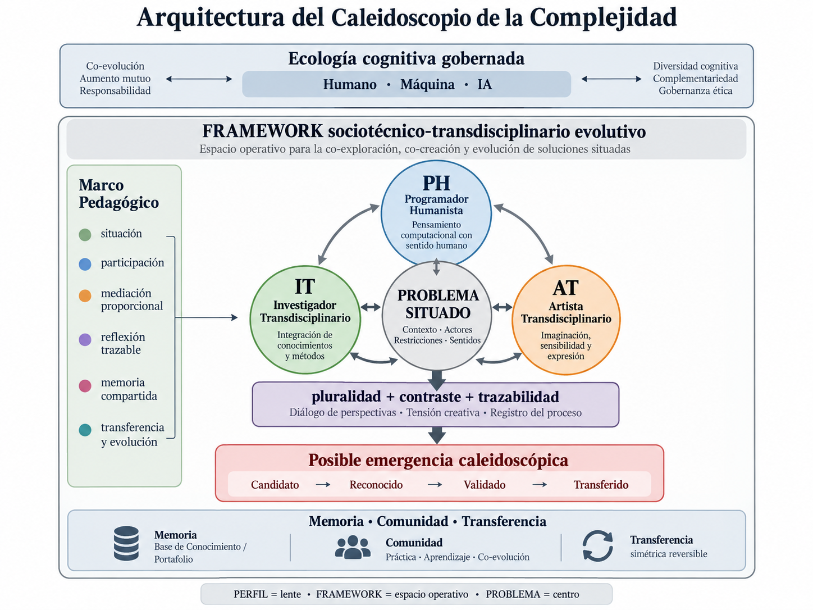

<!--
ARCHIVO DE REFERENCIA DOCUMENTAL | TRANSCRIPCIÓN MD DEL MANUSCRITO FINAL v1.5
Fuente: Caleidoscopio_Complejidad_Ponencia_v1_5_Final.docx
f_sha256: 0fe7ca92685b198316e340760c6b60722a78404b4aadd8e1d8a4ef71c6c15190
Estado: copia de conservación y consulta del manuscrito facilitado por los autores;
no acredita sometimiento, aceptación ni arbitraje completado.
Método: conversión estructural sin revisión conceptual, bibliográfica ni lingüística.
La figura se conserva como activo asociado y la afiliación del pie de página
del Word se coloca bajo los datos de autoría.
-->

# El Caleidoscopio de la Complejidad

**Una arquitectura cognitiva humano-máquina-IA para reconfigurar la producción transdisciplinaria del conocimiento**

Dr. Ricardo Juan Morales De Jesús

ricardo.morales1@upr.edu

Dr. Manuel de J. Reyes Guzmán

manuel.reyes3@upr.edu

*Los autores son Catedráticos del Departamento de Ciencias Físicas, Facultad de Estudios Generales, Universidad de Puerto Rico en Río Piedras.*

**Resumen:** Este artículo presenta el Caleidoscopio de la Complejidad como una posible propiedad emergente de un Framework sociotécnico-transdisciplinario evolutivo para organizar producción de conocimiento en ecologías humano-máquina-IA. El Framework articula tres lentes funcionales: Programador Humanista (PH), Investigador Transdisciplinario (IT) y Artista Transdisciplinario (AT) alrededor de problemas situados y distingue entre cognición distribuida, agencia, autoridad y responsabilidad. Su fundamento incluye un Marco Teórico Longitudinal alimentado por un corpus curado de Educación General; su cuerpo operativo se materializa en la macroestructura 00–21 + 99; y el Portafolio conserva la trayectoria situada del participante. La propuesta integra transferencia simétrica reversible, memoria y gobernanza pedagógica, y distingue materialización arquitectónica de validación empírica. Estudios Generales se propone como raíz y laboratorio académico para investigar estas ecologías cognitivas, sus emergencias y su transferibilidad.

**Palabras clave:** inteligencia artificial generativa; transdisciplinariedad; cognición distribuida; agencia; educación superior.

## 1. Introducción

La irrupción de la inteligencia artificial generativa en la educación superior no representa solo la incorporación de una herramienta. Modifica las condiciones bajo las cuales se busca, organiza, interpreta, produce y comunica conocimiento, y obliga a reconsiderar cómo se distribuyen cognición, autoridad, agencia y responsabilidad. Estas transformaciones se vuelven especialmente relevantes frente a problemas complejos, donde ninguna disciplina, tecnología o actor individual posee por sí solo una perspectiva suficiente.

La ampliación de capacidad generativa no resuelve, por sí misma, los problemas epistemológicos y pedagógicos del conocimiento. Una síntesis lingüísticamente convincente puede ocultar incertidumbre, diferencias metodológicas o incompatibilidades conceptuales. El desafío es organizar relaciones entre personas, máquinas, inteligencia artificial, formas diversas de conocimiento y prácticas de validación sin confundir velocidad de producción con comprensión, ni asistencia tecnológica con sustitución del juicio humano.

En este trabajo denominamos Framework a un sistema sociotécnico-transdisciplinario evolutivo diseñado para organizar esas relaciones alrededor de problemas situados. No equivale a una aplicación, un repositorio ni una metodología lineal: constituye el espacio operativo y de gobernanza dentro del cual pueden activarse lentes diferenciadas, preservarse memoria y trazabilidad, regularse mediaciones humano-máquina-IA y transferirse aprendizajes entre proyectos. Su arquitectura se resume en tres relaciones: perfil = lente; Framework = espacio operativo y evolutivo; problema = centro. Dentro de este sistema se desarrolla el Caleidoscopio de la Complejidad, una hipótesis conceptual que estudia la posibilidad de que el contraste situado entre distintas formas de conocer, crear y construir produzca configuraciones nuevas y trazables de comprensión.

La propuesta se apoya además en un Marco Teórico Longitudinal alimentado por un repositorio curado de fuentes fundacionales de Educación General. Ese corpus se organiza en cuatro áreas: complejidad y transdisciplinariedad; educación y tecnologías emergentes; competencias del siglo XXI y alfabetizaciones; y uso ético y responsable de la inteligencia artificial. Su función no es fijar respuestas eternas, sino mantener abierta una conversación epistemológica y humana capaz de revisar los principios del Framework a medida que cambian las tecnologías, las prácticas y la evidencia.

## 2. Complejidad, fragmentación y transdisciplinariedad

Los problemas complejos articulan dimensiones heterogéneas, distintas escalas, relaciones no lineales y consecuencias distribuidas entre dominios institucionalmente separados. La especialización disciplinaria puede producir análisis rigurosos y, simultáneamente, insuficientes para comprender las relaciones que configuran un problema. El pensamiento complejo y la transdisciplinariedad ofrecen antecedentes fundamentales para esta lectura (Morin, 1999; Nicolescu, 2002). La transdisciplinariedad responde a esa dificultad sin exigir una superdisciplina: busca relacionar formas distintas de conocimiento preservando suficiente especificidad para que exista contraste.

Pohl et al. (2021) conciben la integración transdisciplinaria como un proceso interactivo y multidimensional; Knapp et al. (2019) destacan la pluralidad de conocimientos, los procesos sociales y las relaciones de poder implicadas en su coproducción. Polk (2014) recuerda que integración y participación no garantizan transformación. El Framework adopta, por ello, una posición precisa: complejidad no significa eliminar diferencias; transdisciplinariedad no equivale a fusionarlas; integrar significa relacionarlas sin perder trazabilidad. El problema situado funciona como centro organizador: las perspectivas se convocan porque el problema las necesita, no porque una disciplina aspire a absorber a las demás.

## 3. Humano, máquina e IA: una ecología cognitiva gobernada

Las metáforas de asistencia o copilotaje pueden sugerir una distribución demasiado estable del trabajo cognitivo. En la práctica, las funciones de personas, sistemas generativos y máquinas varían según problema, riesgo, contexto, experiencia y propósito formativo. Distribuir cognición tampoco equivale a distribuir del mismo modo autoridad y responsabilidad. Esta lectura dialoga con la noción de cognición distribuida de Hutchins (1995) y con propuestas recientes de interacción educativa humano-IA como proceso social (Sharples, 2023). El Framework distingue distribución cognitiva, autoridad epistemológica, agencia y responsabilidad: una síntesis puede emerger de personas, IA, datos, herramientas y artefactos; la autoridad epistemológica puede adquirir carácter procesual y colectivo; la responsabilidad ética y material, en cambio, debe seguir siendo atribuible a actores humanos capaces de explicar, revisar y responder por decisiones con consecuencias.

Atchley et al. (2024) subrayan la importancia de la metacognición en la colaboración humano-IA, mientras Yan et al. (2025) señalan posibilidades de apoyo a la reflexión junto con riesgos de dependencia y reducción de vigilancia epistemológica. De ahí dos reglas del Framework: supervisión humana no equivale a agencia humana, y la mediación debe ser proporcional al problema, al riesgo, a la experiencia y al propósito. Como orientación, el Framework propone estructura y reglas; la IA analiza, contrasta y genera alternativas; la máquina ejecuta, registra y evidencia; y el humano interpreta, decide, autoriza y responde. No es una división rígida del trabajo, sino una regla de gobernanza.

## 4. PH, IT y AT: lentes, capacidades y producción de conocimiento

PH, IT y AT son lentes funcionales y capacidades de actuación, no profesiones rígidas ni tipos de personas. Una misma persona puede activar varias lentes, un equipo puede distribuirlas y una comunidad puede desarrollarlas colectivamente. Su valor no reside en ocupar posiciones fijas, sino en introducir preguntas, criterios y capacidades distintas frente al mismo problema. Las tres acceden a un patrimonio epistemológico común y, al mismo tiempo, pueden conservar conocimiento especializado que no necesita disolverse en una síntesis homogénea.

El Programador Humanista (PH) interroga cómo una intención humana puede convertirse en una mediación tecnológica comprensible, sostenible y responsable. Su campo incluye arquitectura, diseño, implementación, interoperabilidad, automatización, experiencia de uso, seguridad, mantenibilidad y consecuencias humanas de las decisiones técnicas. No es simplemente “el técnico”: hace visible que toda implementación materializa supuestos, restricciones, valores y relaciones de poder. Su pregunta orientadora puede formularse así: ¿cómo puede esta intención convertirse en una mediación tecnológica que preserve propósito, legibilidad y responsabilidad humana?

El Investigador Transdisciplinario (IT) interroga preguntas, métodos, evidencia, procedencia, incertidumbre, contraste, límites y criterios de validez. Su aporte no consiste en gobernar jerárquicamente a las otras lentes, sino en gobernar epistemológicamente su propia contribución y aportar esa vigilancia al trabajo colectivo. Pregunta qué sabemos, cómo lo sabemos, qué permanece incierto y qué debe contrastarse antes de sostener una afirmación. Esta función resulta especialmente importante en ecologías mediadas por IA, donde fluidez discursiva y autoridad epistemológica pueden confundirse con facilidad.

El Artista Transdisciplinario (AT) aporta percepción, imaginación, simbolización, materialidad, representación, sensibilidad y experiencia como formas de conocimiento. Su función no es decorar resultados ya establecidos, sino explorar lo que el problema todavía no permite ver, decir o experimentar. La investigación artística permite reconocer que la creación puede participar en la producción de conocimiento valioso y no limitarse a una función expresiva posterior (Borgdorff, 2011; Candy & Edmonds, 2018). Su pregunta orientadora es: ¿qué puede percibirse, imaginarse, representarse o experimentarse de otra manera para revelar dimensiones todavía ocultas del problema?

La potencia transdisciplinaria aparece cuando las lentes conservan suficiente diferencia para producir tensión productiva. PH puede preguntar si algo puede construirse y en qué condiciones; IT, si puede sostenerse epistemológicamente; AT, si puede percibirse o configurarse de otra manera. Ninguna lente agota el problema. El Caleidoscopio depende precisamente de que esas diferencias entren en contraste y puedan modificar la lectura inicial de quienes participan.

## 5. El Caleidoscopio de la Complejidad

La coexistencia de perspectivas no produce automáticamente conocimiento nuevo: PH + IT + AT no equivale, por sí solo, a un Caleidoscopio. El Caleidoscopio designa una posible propiedad emergente de una interacción transdisciplinaria situada. No es un cuarto perfil, un agente adicional, ni una superdisciplina; su unidad de análisis es una transformación reconocible en la configuración del conocimiento, la representación, la decisión o la acción.

El Framework identifica cinco condiciones mínimas: situación real, pluralidad de lentes, contraste efectivo, emergencia de algo nuevo y trazabilidad. van Breda y Swilling (2019) muestran cómo procesos transdisciplinarios pueden transformarse mediante interacción entre contexto, teoría y práctica; Grand et al. (2016) permiten pensar la emergencia de conocimiento como proceso evidenciable. La trazabilidad ocupa una posición central porque permite reconstruir tensiones, contribuciones, intervenciones y decisiones. No siempre es necesario activar las tres lentes, siempre que exista pluralidad suficiente y transformación real.

El Caleidoscopio se propone como constructo cualitativo investigable. El Framework distingue cuatro estados: Candidato → Reconocido → Validado → Transferido. Novedad no equivale a validez y validez local no equivale a transferencia. Gupta et al. (2025) resultan pertinentes al desplazar el análisis desde actores aislados hacia sistemas sociocognitivos humano-máquina; la propuesta aquí se concentra específicamente en posibles emergencias de comprensión transdisciplinaria.

Figura 1. Arquitectura del Caleidoscopio de la Complejidad. El problema situado ocupa el centro del Framework y convoca, según las necesidades del contexto, las lentes PH, IT y AT dentro de una ecología cognitiva humano-máquina-IA gobernada. La figura sintetiza la arquitectura de interacción y las condiciones para una posible emergencia caleidoscópica; el Marco Teórico Longitudinal, la distinción entre memoria epistemológica y memoria situada, y la macroestructura 00–21 + 99 se desarrollan en el texto y no deben interpretarse como agotados por esta representación visual. Fuente: elaboración propia.

## 6. Marco Teórico Longitudinal y Marco Pedagógico

Una ecología cognitiva distribuida no garantiza aprendizaje. El Framework distingue por ello entre el Marco Teórico Longitudinal y su operacionalización pedagógica. El primero constituye el núcleo reflexivo donde convergen un repositorio curado de fuentes fundacionales, el patrimonio epistemológico común, los conocimientos especializados de PH, IT y AT y la base federada de conocimiento. Su función es preservar y hacer evolucionar la discusión sobre principios humanos, epistemológicos, éticos y relacionales que deben orientar la colaboración entre personas, máquinas e inteligencia artificial. No conserva respuestas inmutables: conserva la continuidad de preguntas que el sistema no debe permitir que desaparezcan bajo la presión de la eficiencia o la automatización.

El Marco Pedagógico constituye una traducción operacional vigente de ese fundamento longitudinal. Se organiza alrededor de seis principios: situación antes que abstracción; participación antes que consumo; mediación proporcional; reflexión trazable sobre la acción; memoria compartida; y transferencia y evolución. Estos principios no agotan el Marco Teórico Longitudinal y pueden revisarse cuando nueva evidencia o práctica lo justifique. La GenAI vuelve esta relación especialmente importante: Xu et al. (2025) muestran que el apoyo metacognitivo explícito puede fortalecer autorregulación y autoevaluación, mientras Wang et al. (2026) distinguen patrones de uso que pueden apoyar agencia de otros asociados con descarga cognitiva y dependencia. El ciclo SITUAR → PARTICIPAR → MEDIAR → PRODUCIR → REFLEXIONAR → RECORDAR → TRANSFERIR → EVOLUCIONAR busca mantener esa mediación visible y revisable.

## 7. Agencia, autoridad y responsabilidad

La presencia de una persona en el último paso de un proceso automatizado no garantiza agencia. La agencia exige capacidad para comprender, cuestionar, elegir, justificar, modificar y responder. Ferrario, Facchini y Termine (2024) cuestionan que el alto rendimiento predictivo de una IA sea suficiente para atribuirle autoridad epistemológica, mientras Lloyd (2025) subraya transparencia, verificación y responsabilidad explícita en la producción de conocimiento asistida por IA. En la arquitectura propuesta, la cognición puede distribuirse, la autoridad puede ser procesual y colectiva, y la responsabilidad debe permanecer atribuible.

Esta transformación alcanza también a docentes y estudiantes. Zhai (2025) analiza la evolución de roles docentes en contextos GenAI. Dentro del Framework, el profesor diseña y gobierna condiciones de participación: sitúa problemas, regula mediaciones, hace visible evidencia, provoca contraste, facilita reflexión y preserva memoria. El estudiante deja de ser mero receptor y se convierte en participante epistemológico. Formarse implica aprender no solo qué saber o qué herramientas utilizar, sino también qué delegar, qué no delegar, cómo verificar, justificar y responder.

## 8. Comunidad, memoria y transferencia

El aprendizaje puede desaparecer si no existe infraestructura para preservarlo, pero no toda memoria cumple la misma función. El Framework distingue memoria epistemológica, memoria estructural-evolutiva y memoria situada. La Base de Conocimiento conserva patrimonio epistemológico disponible; la base federada permite relacionar conocimiento distribuido y especializado sin exigir homogeneización; y la macroestructura conserva las relaciones que permiten reconstruir cómo el sistema cambia. Wenger (2011) vincula las comunidades de práctica con aprendizaje colectivo sostenido y repertorio compartido; Brown y Duguid (1991) relacionan práctica, innovación y aprendizaje organizacional. La arquitectura puede crear condiciones para una comunidad de práctica, pero participantes, repositorios y herramientas compartidas no constituyen por sí solos una comunidad consolidada: esta requiere participación sostenida, repertorio común, aprendizaje recíproco y evolución colectiva.

La última versión del Framework v5.3 se encuentra disponible para estudio en un repositorio público de GitHub y contiene enlaces a cuatro repositorios de implementación como prototipos experimentales (Morales De Jesús & Reyes Guzmán, 2026). Los cuatro proyectos fueron situados en educación universitaria, formación metodológico-estadística, curaduría bibliográfica e investigación asistida por IA, y ensayan como pilotos experimentales la integración del Framework v5.2. Los proyectos documentados en repositorios públicos ofrecen condiciones iniciales para estudiar el aprendizaje recíproco entre proyectos, sin demostrar todavía una comunidad de práctica consolidada ni transdisciplinaria.

El PORTAFOLIO pertenece a otro nivel: la implementación situada. Su función es ayudar al participante humano a mantener orientación dentro de la complejidad del Framework desde su nivel, trayectoria y perspectiva particulares. Puede registrar decisiones, dudas, tensiones, elecciones de lente, cambios de interpretación, artefactos y justificaciones. En este sentido, la macroestructura preserva la continuidad del sistema, mientras el Portafolio preserva la continuidad de la experiencia humana dentro del sistema. Esa trayectoria puede convertirse en una fuente de evidencia para estudiar reconfiguraciones cognitivas asociadas con una eventual emergencia caleidoscópica.

La transferencia se concibe como simétrica y reversible: Framework ↔ proyecto. El Framework transfiere principios, conocimiento, estructuras, métodos y artefactos; los proyectos pueden devolver hallazgos, tensiones, contraejemplos y nuevo conocimiento situado. Sin embargo, retorno no equivale a incorporación automática al patrimonio común. Adler et al. (2018) y Nagy et al. (2020) muestran la importancia del contexto y la reciprocidad en la transferencia transdisciplinaria. El aprendizaje situado debe conservar procedencia, entrar nuevamente en contraste y atravesar un gate humano antes de permanecer local, especializarse o integrarse al canon.

## 9. Operacionalización del Framework

El Framework no es solo formulación conceptual: ha sido materializado mediante estructuras, procesos y artefactos observables. Su cuerpo estructural es la macroestructura 00–21 + 99. Describirla únicamente como “gramática común” resulta insuficiente: cada cartapacio contiene un espacio determinado para atender una dimensión de la complejidad del proyecto; su articulación ofrece un lenguaje común para relacionar situación, actores, conocimiento, decisiones, evidencia, prácticas, gobernanza, memoria y evolución. Así, 00–21 + 99 funciona como una anatomía distribuida y memoria estructural-evolutiva del sistema.

Su activación es proporcional a cada proyecto: no se trata de llenar carpetas, sino de conservar relaciones suficientes para comprender qué ocurrió y qué puede transferirse. Esa continuidad constituye la base estructural de la transferencia simétrica reversible, sin borrar diferencias ni incorporar automáticamente aprendizajes al patrimonio común. Los objetos compartidos y la conservación de versiones favorecen coordinación y trazabilidad (Nicolini et al., 2012; Vuorre & Curley, 2018). Operacionalización, sin embargo, no equivale a validación empírica.

## 10. Estudios Generales como laboratorio académico

La propuesta adquiere especial interés en Estudios Generales no solo por su vocación integradora, sino porque parte del sustrato epistemológico del Framework fue curado y organizado precisamente desde ese territorio académico. El repositorio fundacional que alimenta el Marco Teórico Longitudinal articula cuatro áreas: complejidad y transdisciplinariedad; educación y tecnologías emergentes; competencias del siglo XXI y alfabetizaciones; y uso ético y responsable de la inteligencia artificial. En conjunto, estas áreas relacionan fundamento epistemológico, transformación educativa, formación del sujeto contemporáneo y horizonte normativo.

Esta configuración convierte a Estudios Generales en un laboratorio académico especialmente fértil para estudiar problemas que cruzan humanidades, ciencias, arte, tecnología, cultura, ciudadanía y ética. No se trata de imponer una síntesis disciplinaria, sino de crear condiciones para que distintas formas de conocimiento entren en diálogo y contraste sin perder especificidad. Esto exige aprender a formular problemas, contextualizar, relacionar conocimientos, reconocer incertidumbre, crear, verificar, decidir y justificar. PH, IT y AT ofrecen una arquitectura para organizar parte de esa pluralidad; el Portafolio permite observar cómo cada participante navega esa complejidad; y la transferencia reversible permite que aprendizajes situados regresen al sistema sin convertirse automáticamente en canon.

Por ello, Estudios Generales puede operar simultáneamente como raíz, espacio de integración, laboratorio de investigación y espacio de retorno. Esta posición no demuestra todavía superioridad empírica frente a otros contextos, pero proporciona un terreno coherente para investigar cómo se desarrollan capacidades transdisciplinarias, cómo se distribuye cognición en ecologías humano-máquina-IA y en qué condiciones puede reconocerse una transformación caleidoscópica.

## 11. Evidencia, límites y agenda de validación

La propuesta mantiene una separación estricta entre cuatro niveles de evidencia: descriptivo, que indica qué existe; arquitectónico, para qué fue diseñado; teórico, qué relaciones se proponen; y empírico, qué efectos deben comprobarse. Puede afirmarse que el Framework ha sido diseñado, documentado, versionado, operacionalizado y utilizado en proyectos reales, y que busca hacer visibles relaciones cognitivas, conservar trazabilidad y facilitar participación, reflexión y transferencia. No puede afirmarse todavía que mejore sistemáticamente el aprendizaje, preserve necesariamente la agencia, produzca mejores decisiones, genere Caleidoscopios de manera consistente, asegure transferencia, produzca una comunidad de práctica madura o sea superior a otros modelos.

La literatura reciente sobre GenAI refuerza esta prudencia. Han, Peng y Liu (2025) identifican efectos positivos generales junto con heterogeneidad considerable; Chen y Cheung (2025) encuentran beneficios en distintos resultados universitarios, pero no un efecto estadísticamente significativo sobre metacognición. Belcher y Claus (2025) refuerzan, desde la evaluación transdisciplinaria, la necesidad de atender diseño, proceso, integración y resultados. La agenda del Framework debe avanzar de manera iterativa mediante uso, observación, documentación, contraste, evaluación, transferencia y revisión. Para el Caleidoscopio, la prioridad inicial es estudiar si sus cinco condiciones pueden reconocerse con consistencia entre casos y observadores, atendiendo también riesgos de dependencia, delegación excesiva, falsa trazabilidad, homogeneización, consenso artificial y autoridad ilegítima. En este sentido, el Framework puede caracterizarse como una hipótesis arquitectónica materializada.

## 12. Discusión y conclusión

El argumento desplaza la discusión desde las capacidades aisladas de la IA hacia la arquitectura de relaciones dentro de la cual esas capacidades operan. La pregunta deja de ser únicamente qué puede hacer la IA y pasa a ser cómo gobernar una ecología cognitiva en la que diferentes capacidades participan en un mismo problema. Un segundo desplazamiento consiste en reconocer que integración no significa homogeneización. PH, IT y AT intentan preservar diferencias epistemológicas y capacidades especializadas dentro de una práctica compartida: unidad sin uniformidad y diferencia sin aislamiento.

El Caleidoscopio no representa la suma de perspectivas, sino una posible reconfiguración producida por contraste situado y trazable. El Marco Teórico Longitudinal aporta continuidad a las preguntas humanas y epistemológicas que orientan el sistema; el Marco Pedagógico traduce ese fundamento en condiciones de participación, mediación, reflexión, memoria y transferencia; la macroestructura 00–21 + 99 conserva el cuerpo y la historia evolutiva del proceso; y el Portafolio mantiene visible la trayectoria situada del participante. Estas funciones diferenciadas permiten que memoria, práctica y conocimiento se relacionen sin confundirse.

La contribución de este trabajo se concentra así en seis componentes relacionados: una arquitectura para gobernar interacción humano-máquina-IA alrededor de problemas complejos; PH, IT y AT como lentes y capacidades transdisciplinarias; un Marco Teórico Longitudinal alimentado por un corpus fundacional de Educación General; la macroestructura 00–21 + 99 como cuerpo operativo y memoria evolutiva; el Caleidoscopio como constructo para estudiar posibles emergencias de comprensión; y la transferencia simétrica reversible como mecanismo mediante el cual el Framework puede aprender de sus implementaciones sin confundir experiencia local con verdad permanente.

La pregunta futura no es simplemente si el Caleidoscopio “funciona”, sino en qué condiciones emerge, cómo puede reconocerse, qué mediaciones lo favorecen, qué efectos tiene sobre la agencia y qué parte de sus resultados puede transferirse a nuevas situaciones. El Framework debe aprender de sus propias implementaciones sin convertir conocimiento situado en verdad permanente: su canon debe permanecer versionado, trazable y revisable. El desafío universitario no consiste en decidir cuánto pensamiento delegar, sino en diseñar ecologías cognitivas en las que humanos, máquinas e IA amplíen conjuntamente las posibilidades de conocer sin perder la capacidad humana de comprender, cuestionar, decidir y responder por aquello que producen.

## Referencias

Adler, C., Hirsch Hadorn, G., Breu, T., Wiesmann, U., & Pohl, C. (2018). Conceptualizing the transfer of knowledge across cases in transdisciplinary research. Sustainability Science, 13, 179–190. https://doi.org/10.1007/s11625-017-0444-2

Atchley, P., Pannell, H., Wofford, K., Hopkins, M., & Atchley, R. A. (2024). Human and AI collaboration in the higher education environment: Opportunities and concerns. Cognitive Research: Principles and Implications, 9, Article 20. https://doi.org/10.1186/s41235-024-00547-9

Belcher, B. M., & Claus, R. (2025). A quality assessment framework for transdisciplinary research design, monitoring, and evaluation: Guidance for application. MethodsX, 14, 103264. https://doi.org/10.1016/j.mex.2025.103264

Borgdorff, H. (2011). The production of knowledge in artistic research. In M. Biggs & H. Karlsson (Eds.), The Routledge companion to research in the arts (pp. 44–63). Routledge.

Brown, J. S., & Duguid, P. (1991). Organizational learning and communities-of-practice: Toward a unified view of working, learning, and innovation. Organization Science, 2(1), 40–57. https://doi.org/10.1287/orsc.2.1.40

Candy, L., & Edmonds, E. (2018). Practice-based research in the creative arts: Foundations and futures from the front line. Leonardo, 51(1), 63–69. https://doi.org/10.1162/LEON_a_01471

Chen, S., & Cheung, A. C. K. (2025). Effect of generative artificial intelligence on university students’ learning outcomes: A systematic review and meta-analysis. Educational Research Review, 49, 100737. https://doi.org/10.1016/j.edurev.2025.100737

Ferrario, A., Facchini, A., & Termine, A. (2024). Experts or authorities? The strange case of the presumed epistemic superiority of artificial intelligence systems. Minds and Machines, 34, Article 30. https://doi.org/10.1007/s11023-024-09681-1

Grand, J. A., Braun, M. T., Kuljanin, G., Kozlowski, S. W. J., & Chao, G. T. (2016). The dynamics of team cognition: A process-oriented theory of knowledge emergence in teams. Journal of Applied Psychology, 101(10), 1353–1385. https://doi.org/10.1037/apl0000136

Gupta, P., Nguyen, T. N., Gonzalez, C., & Woolley, A. W. (2025). Fostering collective intelligence in human–AI collaboration: Laying the groundwork for COHUMAIN. Topics in Cognitive Science, 17(2), 189–216. https://doi.org/10.1111/tops.12679

Han, X., Peng, H., & Liu, M. (2025). The impact of GenAI on learning outcomes: A systematic review and meta-analysis of experimental studies. Educational Research Review, 48, 100714. https://doi.org/10.1016/j.edurev.2025.100714

Hutchins, E. (1995). Cognition in the wild. MIT Press. https://doi.org/10.7551/mitpress/1881.001.0001

Knapp, C. N., Reid, R. S., Fernández-Giménez, M. E., Klein, J. A., & Galvin, K. A. (2019). Placing transdisciplinarity in context: A review of approaches to connect scholars, society and action. Sustainability, 11(18), 4899. https://doi.org/10.3390/su11184899

Lloyd, D. (2025). Epistemic responsibility: Toward a community standard for human-AI collaborations. Frontiers in Artificial Intelligence, 8, 1635691. https://doi.org/10.3389/frai.2025.1635691

Morales De Jesús, R. J. & Reyes Gumán, M. de J. (2026). Framework Genérico: El Caleidoscopio de la Complejidad (versión 5.3.0) \[Repositorio de código y documentación\]. GitHub. https://github.com/ricardojuanmorales/framework-proyecto-generico-ia-1

Morin, E. (1999). Los siete saberes necesarios para la educación del futuro. UNESCO.

Nagy, E., Ransiek, A., Schäfer, M., Lux, A., Bergmann, M., Jahn, T., Marg, O., & Theiler, L. (2020). Transfer as a reciprocal process: How to foster receptivity to results of transdisciplinary research. Environmental Science & Policy, 104, 148–160. https://doi.org/10.1016/j.envsci.2019.11.007

Nicolescu, B. (2002). Manifesto of transdisciplinarity. State University of New York Press.

Nicolini, D., Mengis, J., & Swan, J. (2012). Understanding the role of objects in cross-disciplinary collaboration. Organization Science, 23(3), 612–629. https://doi.org/10.1287/orsc.1110.0664

Pohl, C., Klein, J. T., Hoffmann, S., Mitchell, C., & Fam, D. (2021). Conceptualising transdisciplinary integration as a multidimensional interactive process. Environmental Science & Policy, 118, 18–26. https://doi.org/10.1016/j.envsci.2020.12.005

Polk, M. (2014). Achieving the promise of transdisciplinarity: A critical exploration of the relationship between transdisciplinary research and societal problem solving. Sustainability Science, 9(4), 439–451. https://doi.org/10.1007/s11625-014-0247-7

Sharples, M. (2023). Towards social generative AI for education: Theory, practices and ethics. Learning: Research and Practice, 9(2), 159–167. https://doi.org/10.1080/23735082.2023.2261131

van Breda, J., & Swilling, M. (2019). The guiding logics and principles for designing emergent transdisciplinary research processes: Learning experiences and reflections from a transdisciplinary urban case study in Enkanini informal settlement, South Africa. Sustainability Science, 14(3), 823–841. https://doi.org/10.1007/s11625-018-0606-x

Vuorre, M., & Curley, J. P. (2018). Curating research assets: A tutorial on the Git version control system. Advances in Methods and Practices in Psychological Science, 1(2), 219–236. https://doi.org/10.1177/2515245918754826

Wang, G., Wang, W., Yang, D., & Ren, J. (2026). Generative AI, cognitive offloading, and learner agency in higher education: A scoping review. Behavioral Sciences, 16(7), 1150. https://doi.org/10.3390/bs16071150

Wenger, E. (2011). Communities of practice: A brief introduction. National Science Foundation. https://hdl.handle.net/1794/11736

Xu, X., Qiao, L., Cheng, N., Liu, H., & Zhao, W. (2025). Enhancing self-regulated learning and learning experience in generative AI environments: The critical role of metacognitive support. British Journal of Educational Technology, 56(5), 1842–1863. https://doi.org/10.1111/bjet.13599

Yan, L.-X., Pammer-Schindler, V., Mills, C., Nguyen, A., & Gašević, D. (2025). Beyond efficiency: Empirical insights on generative AI’s impact on cognition, metacognition and epistemic agency in learning. British Journal of Educational Technology, 56(5), 1675–1685. https://doi.org/10.1111/bjet.70000

Zhai, X. (2025). Transforming teachers’ roles and agencies in the era of generative AI: Perceptions, acceptance, knowledge, and practices. Journal of Science Education and Technology, 34, 1323–1333. https://doi.org/10.1007/s10956-024-10174-0

## Declaración de transparencia en el uso de inteligencia artificial generativa

En la elaboración de esta ponencia, los autores utilizaron inteligencia artificial generativa como apoyo a la investigación, reflexión, organización conceptual, redacción, revisión y preparación de materiales derivados. Herramientas como ChatGPT de OpenAI, Claude de Anthropic, Gemini y NotebookLM de Google, Consensus, Perplexity se utilizaron para triangulación bibliográfica y documentación multimodal. En particular, se emplearon Proyectos en ChatGPT de OpenAI, para explorar y contrastar alternativas conceptuales, sintetizar discusiones, revisar coherencia y redundancias, refinar el lenguaje académico, preparar versiones sucesivas del manuscrito y apoyar la revisión y normalización bibliográfica.

La IA también se utilizó como instrumento de planificación estratégica, sistémica, holística y transdisciplinaria para la reflexión en acción durante el desarrollo y evolución del Framework buscando una integración eficiente de humano, máquina e IA. Sus aportaciones fueron tratadas como insumos provisionales sujetos a examen crítico, nunca como evidencia independiente ni autoridad epistemológica autónoma. Los autores revisaron, aceptaron, modificaron o rechazaron sus propuestas conforme a su juicio académico, la documentación canónica y las fuentes consultadas, preservando su procedencia y autoridad. Asimismo, distinguieron entre afirmaciones descriptivas, arquitectónicas, teóricas y empíricas para evitar atribuir efectos no validados a la implementación tecnológica.

Algunas representaciones conceptuales y recursos gráficos fueron desarrollados con apoyo de herramientas generativas, bajo conceptos y criterios definidos y revisados por los autores. Su función es ilustrativa y comunicativa, no de evidencia empírica. Los autores asumen conjuntamente la responsabilidad final por los contenidos, las fuentes, los argumentos, las decisiones editoriales, la exactitud y las conclusiones del manuscrito. Esta declaración expresa el compromiso del Framework con la transparencia, la trazabilidad y un principio fundamental: la cognición puede distribuirse, pero la responsabilidad académica permanece humana.
