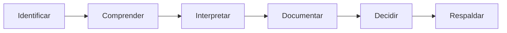

# IEISP · Informe Ejecutivo Integral de Situación del Framework v5.3.0

*El bosque completo: estado, evidencia, riesgos y decisiones.*

**Fecha de corte:** 21 de octubre de 2026. **Objeto:** Framework Genérico v5.3.0 como sistema sociotécnico-transdisciplinario evolutivo, no solamente app ni repositorio. **Estado:** **APROBADO PARA PILOTO EXPERIMENTAL · AHE 2026-10-21; validaciones empíricas y TSR independientes siguen pendientes.** La aprobación autoriza este producto documental como piloto, no demuestra impacto pedagógico ni validación externa.

**Cómo leer:** [F] hecho respaldado por el expediente consultado; [I] interpretación editorial; [H] hipótesis; [P] propuesta; [NV] no verificado en este corte. Un registro GitHub es evidencia documental de una operación, no validación pedagógica o epistemológica independiente.

> **Límite editorial:** este informe no reproduce ni enlaza la ponencia sometida a arbitraje. Solo utiliza fuentes públicas autorizadas y registros históricos del Framework.

## Portada, síntesis visual e índice anotado

**Dictamen aprobado para piloto [I]:** **APTO PARA CONTINUIDAD OPERACIONAL Y PILOTOS CONTROLADOS**, condicionado para validación empírica, TSR multicaso y adopción institucional general. La **AHE 2026-10-21** aprueba su uso como piloto documental; no constituye certificación técnica adicional ni empírica.

**Lectura de dos minutos:** release estable y app documentadas; arquitectura canónica y tríada genérica disponible; cuatro proyectos heterogéneos; deuda de validación y cotejo Local_First. Las seis partes del IEISP son Identificar, Comprender, Interpretar, Documentar, Decidir y Respaldar.

*Figura IEISP-1. Secuencia del juicio situacional. Texto alternativo: seis operaciones encadenadas, cuya decisión depende del soporte y la evidencia.*

## I. Identificar

**[F] Objeto.** Framework v5.3.0, sistema sociotécnico-transdisciplinario evolutivo, no equivalente a la aplicación, el repositorio ni una suma de instrumentos. El problema situado organiza la activación de las lentes PH, IT y AT. La release estable está documentada por G-REL53 y el commit `bdc7d9d7...`.

**Resumen ejecutivo.** La infraestructura muestra un nivel apreciable de materialización técnica y gobernanza documental. Los procesos de publicación y pruebas de navegador sintéticas están documentados como exitosos. Los pilotos experimentales EME, IA en Acción, RIB-EG-IA y EugenIA/BIVA están descritos públicamente con límites diferenciados. Faltan cotejo físico del root Local_First, evaluación con usuarios, evidencia de transferencia semántica bidireccional y certificación interproyectos de N3/N4. **[I]** La decisión defendible es sostener operaciones y pruebas controladas, no declarar eficacia universal.

## II. Comprender

**[F] Genealogía verificable:** v5.0.0 (septiembre); v5.1.0 y canon (6–8 de octubre); v5.2.0 (9–10 de octubre); piloto IEISP/PIEF v0.5.3 y PR #13 (20 de octubre); release G-REL53 estable v5.3.0 (20–21 de octubre); estándar genérico MH–IEISP–PIEF v1.0 fusionado mediante PR #18 (21 de octubre). Los informes anteriores permanecen como registros del estado conocido entonces.

**[F] Fundamentos:** Marco Teórico Longitudinal, principios pedagógicos vigentes, corpus fundacional en cuatro áreas, lente PH/IT/AT no jerárquica, Base Federada, Portafolio y transferencia reversible condicionada. **[NV]** No se aportaron en este corte mediciones longitudinales de aprendizaje ni resultados comparativos externos.

## III. Interpretar: ocho lentes

| Lente | Hallazgo con evidencia | Límite y consecuencia |
|---|---|---|
| Estratégica | [I] Priorizar una demostración replicable de valor situado. | No sustituir validación de usuarios por número de documentos. |
| Sistémica | [F] Canon, release, Wiki y pilotos coexisten con estados distintos. | Reconciliar instancias y ubicaciones Local_First. |
| Holística | [I] La experiencia humana debe orientar mediaciones. | Cotejar carga cognitiva, accesibilidad y autonomía. |
| Transdisciplinaria | [F] PH/IT/AT constituyen lentes diferenciadas; cuatro casos heterogéneos. | [NV] No hay comunidad madura ni emergencia universal. |
| Epistemológica | [F] Se distinguen [F/H/I/P/NV] y niveles de evidencia. | Evitar convertir diseño en resultado observado. |
| Tecnológica | [F] CI Node/Chromium, portabilidad y release v5.3.0 documentadas. | No afirmar prueba universal de seguridad ni plataforma. |
| Ética | [F] Política Local_First y reserva de datos de estudiantes/terceros. | Comprobar permisos y prácticas reales de custodia. |
| Gobernanza | [F] G-FW53-EXEC-01 y G-REL53 tienen alcances distintos; PR #18 formaliza modelos. | IEISP aprobado para piloto por AHE 2026-10-21; sus límites de evidencia permanecen. |

## IV. Documentar

### Mapa de autoridad y memoria

| Fuente | Residencia/autoridad | Estado al corte |
|---|---|---|
| Arquitectura conceptual integrada 8-X | Cartapacio 02, canónica conceptual | Vigente y revisable. |
| Release v5.3.0 | Tag y asset oficial | Publicada; evidencia técnica de alcance acotado. |
| IEISP/PIEF v0.5.3 | Plantillas_Evaluacion/Framework_v0.5.3 | Pilotos anteriores, no reescritos. |
| Plantillas MH/IEISP/PIEF v1.0 | Cartapacio 07 + norma 00 y guías 21 | Genéricas canónicas tras PR #18. |
| Este informe v0.1.0-piloto | Primera instancia situada | AHE 2026-10-21: aprobado para piloto experimental; validaciones externas pendientes. |

### Evidencia y deuda priorizada

| Grupo | Evidencia actual | Estado propuesto |
|---|---|---|
| Publicación y app | [F] Workflows Release/Pages; pruebas sintéticas | Hito técnico acreditado para commit release. |
| T1–T8 | [F] Diseño de contratos y matriz pública preliminar | [NV] TSR global no validada. |
| Local_First raíz | [F] Custodia local declarada; conteo de ignorados previo | [NV] Cotejo privado externo pendiente. |
| Cuatro pilotos | [F] READMEs públicos y actividades heterogéneas | [NV] N3/N4 transversal no acreditada. |
| Deuda 21 clases | [F] Taxonomía FD/AR/ME/TE/GO | Conciliación de pago y residual pendiente. |

## V. Decidir

**Dictamen aprobado para piloto [I]: APTO PARA CONTINUIDAD OPERACIONAL Y PILOTOS CONTROLADOS.** No se propone nueva declaración de estabilidad técnica, pues esa publicación ya tuvo gate G-REL53; tampoco se certifica impacto educativo, seguridad universal o éxito de TSR. **Reserva esencial:** separar entrega reproducible de transferencia de conocimiento validada.

**Gate humano de este IEISP:** **APROBADO PARA PILOTO EXPERIMENTAL (AHE 2026-10-21).** Esta aprobación es distinta de la canonización anterior de las plantillas v1.0. **Próximo movimiento mínimo [P]:** seleccionar un ensayo independiente F2↔F3 con fichas espejo, consentimiento y criterio T1–T8 explícitos.

## VI. Respaldar

**Trazabilidad técnica:** commit de release `bdc7d9d7bfd2f923b5af9b50154cda378928ce06`; release y páginas documentadas como exitosas en cierre posrelease. **Trazabilidad editorial:** PR #18, estándar genérico v1.0 y registro de adopción. **Límite:** no se ejecutaron nuevas pruebas de software, entrevistas ni auditorías de datos privados durante la elaboración de este informe.

## Fuentes y transparencia de IA

Este informe fue estructurado y redactado con ayuda de ChatGPT de OpenAI a partir de documentos del repositorio y el expediente histórico compartido. La IA no realizó observaciones presenciales, ensayos de usuario ni validaciones científicas externas. La AHE humana aprobó el uso documental de piloto; los autores conservan la responsabilidad de corroborar fuentes y autorizar cualquier publicación académica o validación externa. No se incluyeron datos privados del cartapacio Local_First.

**Fuentes documentales principales:**
- [canon](https://github.com/ricardojuanmorales/framework-proyecto-generico-ia-1/blob/main/02_ARQUITECTURA_CONCEPTUAL/Arquitecturas_Referencia/2026-10-08_Arquitectura_Conceptual_Integrada_Framework_Canon_v1_0.md)
- [release](https://github.com/ricardojuanmorales/framework-proyecto-generico-ia-1/releases/tag/v5.3.0)
- [cierre](https://github.com/ricardojuanmorales/framework-proyecto-generico-ia-1/blob/main/18_DOCUMENTACION_ACTIVA/Cierres_Reportes/Cierres_Sesion/2026-10-20_Cierre_Fuerte_PostRelease_Framework_V5_3_0.md)
- [deuda](https://github.com/ricardojuanmorales/framework-proyecto-generico-ia-1/blob/main/20_MANTENIMIENTO_Y_EVOLUCION/Deuda_Tecnica/2026-10-20_Deuda_Sistemica_FW53_v0.5.3.md)
- [piloto_ieisp](https://github.com/ricardojuanmorales/framework-proyecto-generico-ia-1/blob/main/07_PLANTILLAS_Y_MODELOS/Plantillas_Evaluacion/Framework_v0.5.3/IEISP_Framework_V0.5.3.md)
- [piloto_pief](https://github.com/ricardojuanmorales/framework-proyecto-generico-ia-1/blob/main/07_PLANTILLAS_Y_MODELOS/Plantillas_Evaluacion/Framework_v0.5.3/PIEF_Framework_V0.5.3.md)
- [gate](https://github.com/ricardojuanmorales/framework-proyecto-generico-ia-1/blob/main/18_DOCUMENTACION_ACTIVA/Cierres_Reportes/Reportes_Evaluacion/2026-10-21_Registro_Adopcion_Triada_Documental_v1_0_CANDIDATO.md)

**Registro de autorización situada:** Aprobación Humana Expedita expresa del 21-X-2026: «Marcar como Aprobado para Piloto Experimental». No se aprueban por inferencia resultados que el informe identifica como no verificados.

**Acta de la aplicación:** [AHE y registro de publicación](ACTA_AHE_TRÍADA_v5_3_0_2026-10-21.md).

**Control de versiones:** el corte de los pilotos IEISP y PIEF v0.5.3 (20-X-2026) precede a la publicación estable v5.3.0. Se usa como antecedente y no se reescribe su dictamen histórico. Los informes presentes son primeras *instancias aprobadas para piloto experimental* de modelos genéricos v1.0, no sustituyen fuentes ni autorizan TSR automática.
