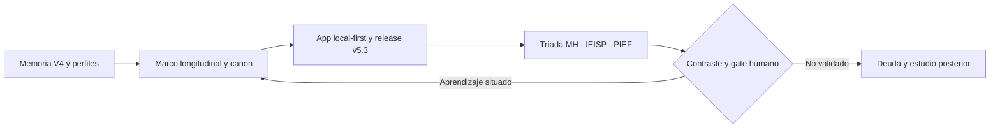

# Memoria Histórica (MH) · Framework v5.3.0

*De una gramática documental a un sistema de aprendizaje gobernado.*

**Fecha de corte:** 21 de octubre de 2026. **Objeto:** Framework Genérico v5.3.0 como sistema sociotécnico-transdisciplinario evolutivo, no solamente app ni repositorio. **Estado:** **APROBADO PARA PILOTO EXPERIMENTAL · AHE 2026-10-21; validaciones empíricas y TSR independientes siguen pendientes.** La aprobación autoriza este producto documental como piloto, no demuestra impacto pedagógico ni validación externa.

**Cómo leer:** [F] hecho respaldado por el expediente consultado; [I] interpretación editorial; [H] hipótesis; [P] propuesta; [NV] no verificado en este corte. Un registro GitHub es evidencia documental de una operación, no validación pedagógica o epistemológica independiente.

> **Límite editorial:** este informe no reproduce ni enlaza la ponencia sometida a arbitraje. Solo utiliza fuentes públicas autorizadas y registros históricos del Framework.

## 0. Entrada e índice anotado

Este registro narra la maduración del Framework desde V4 hacia v5.3.0. Secciones: (1) síntesis y estado; (2) cronología comprobable; (3) arquitectura y aprendizajes; (4) mapa visual; (5) evidencia y deuda; (6) horizontes; (7) continuidad; (8) fuentes y declaración de IA. No reproduce la memoria v5.2.0 aprobada, ni altera las versiones anteriores.

## 1. Resumen ejecutivo y estado de corte

**[F] La release v5.3.0 estable está publicada.** El cierre posrelease la asocia al tag y commit `bdc7d9d7bfd2f923b5af9b50154cda378928ce06`, al workflow de publicación y a GitHub Pages con ejecución exitosa. El archivo ZIP versionado incorpora una huella SHA-256 declarada en el registro; **[NV]** este informe no repitió una descarga independiente para cotejarla byte a byte.

**[F]** La arquitectura conceptual canónica de 8-X-2026 organiza problema situado, lentes PH/IT/AT, Marco Teórico Longitudinal y Pedagógico, conocimiento federado, macroestructura 00–21 + 99, Portafolio y transferencia reversible. **[I]** La relevancia histórica de v5.3.0 es que lleva esa discusión a una materialización estable, distribuible y con instrumentos documentales piloto, sin convertir el sistema en una simple aplicación.

**[F]** IEISP y PIEF v0.5.3 se conservaron como ediciones documentales experimentales; la tríada genérica MH–IEISP–PIEF v1.0 fue canonizada por PR #18 el 21-X-2026, y sus primeras instancias situadas se aprobaron para piloto experimental mediante AHE de 21-X-2026. **[NV]** Ni las cuatro implementaciones piloto ni una comunidad de práctica consolidada constituyen validación transdisciplinaria demostrada.

## 2. Cronología y genealogía

| Fecha o período | Hito documentado | Alcance y distinción |
|---|---|---|
| Mayo-junio 2026 | [F] V4 y constitución documental de PH, IT, AT y memoria compartida | Arquitectura de gobierno y archivos, sin convertir perfiles en jerarquía. |
| 16-22 septiembre | [F] Formalización y contraste de perfiles, bases comunes y decisiones | Las lentes mantienen autonomía epistemológica. |
| 24-25 septiembre | [F] v5.0.0: app local-first, estado vivo y portabilidad documentada | Avance técnico, no eficacia docente general. |
| 6 octubre | [F] v5.1.0: pedagogía y conocimiento articulados | El marco longitudinal preserva la pregunta humana. |
| 8-10 octubre | [F] Canon conceptual 8-X, release 5.2.0 y README narrativo | El diseño conceptual y los artefactos operativos avanzan con versiones distintas. |
| 19-20 octubre | [F] Acuerdos R1/R2, PR #13, IEISP/PIEF piloto, pruebas de navegador y distribución | Evidencia técnica delimitada y aprobación experimental, no TSR multicaso. |
| 20-21 octubre | [F] Gate G-REL53 y release estable v5.3.0 | Commit `bdc7d9d`; workflows Release y Pages exitosos. |
| 21 octubre | [F] PR #18 y estándar editorial de MH–IEISP–PIEF | Tres plantillas genéricas aprobadas, distintas de las instancias presentes. |

La cronología reconstruye **cortes diferentes**: lo que los pilotos decían antes del release no se sustituye retroactivamente por lo ocurrido después. Esta es una condición de memoria responsable, no una contradicción que haya que ocultar.

## 3. Arquitectura y aprendizaje del período

**[I] Tres transformaciones conectadas:** (a) memoria documental hacia relaciones reconstruibles; (b) lente individual hacia contraste transdisciplinario situado; (c) instrumento aislado hacia familia documental complementaria. La macroestructura 00–21 + 99 ofrece espacios para la complejidad proporcional de los proyectos, mientras el Portafolio protege la continuidad del participante. El Marco Teórico Longitudinal permite no confundir revisión técnica con fundamento epistemológico.

**[F]** La aplicación declara funcionamiento Local_First, exportación/importación JSON/ZIP y modos START/INTEGRATE/AUDIT; los registros de CI incluyen pruebas sintéticas de sus recorridos y recuperación por segundo runner. **[I]** Ese avance es fuerte como infraestructura verificable, todavía insuficiente como prueba de agencia formativa o aprendizaje situado. La discusión pasa de «¿funciona el software?» a «¿qué sabe el sistema sobre sus propias decisiones y qué puede demostrar?».

## 4. Mapa visual de la época

*Figura MH-1. Esquema conceptual editorial, no una reconstrucción empírica de transferencia. Texto alternativo: recorrido desde memoria y lentes hacia canon, materialización técnica, instrumentos y retorno condicionado.*

## 5. Evidencia, límites y deuda

| Afirmación | Clase | Evidencia | Límite |
|---|---|---|---|
| Release v5.3.0 publicada y Pages desplegada | [F] | Cierre posrelease; release y workflows | Sin recalcular el hash descargando el ZIP en este informe. |
| Flujos START/INTEGRATE/AUDIT recorridos en navegador | [F] | CI sintética Node/Chromium | No evaluación con usuarios reales. |
| Arquitectura y macroestructura canónicas | [F] | Documento rector 8-X-2026 | Canon revisable, no verdad científica universal. |
| Cuatro pilotos conectados documentalmente | [F] | README principal y matriz piloto | No prueba comunidad madura o TSR validada. |
| Emergencia caleidoscópica | [H] | Hipótesis conceptual | No demostrada en casos y observadores independientes. |
| Conciliación de 21 clases de deuda | [F]/[NV] | Registro preliminar y cierre | Registro histórico no equivale a saldo final auditado. |

## 6. Horizontes proporcionales

**Corto plazo [P]:** probar integridad del artefacto descargado fuera de GitHub, sincronizar cartapacio Local_First con estados versionados sin divulgar privados, y evaluar la primera ejecución de la tríada. **Mediano plazo [P]:** comparar F2/F3 entre proyectos, verificar T1–T8 mediante retorno y receptor independiente, y observar agencia humana con metodología explícita. **Largo plazo [P]:** sostener comunidad de práctica con participación real, prácticas de revisión y evidencias longitudinales; mantener autonomía de lentes PH/IT/AT.

## 7. Cierre de época y continuidad

El hito no es simplemente la cifra 5.3.0. Es disponer de un sistema que puede conservar procedencia al tiempo que aprende sin declarar que todo aprendizaje ya está validado. La memoria histórica pone en secuencia los cambios, sin atribuir a la infraestructura lo que solamente el estudio situado podrá comprobar. **La siguiente historia debe escribirse con evidencia de personas, prácticas y retornos reales.**

## Fuentes y transparencia de IA

Este informe fue estructurado y redactado con ayuda de ChatGPT de OpenAI a partir de documentos del repositorio y el expediente histórico compartido. La IA no realizó observaciones presenciales, ensayos de usuario ni validaciones científicas externas. La AHE humana aprobó el uso documental de piloto; los autores conservan la responsabilidad de corroborar fuentes y autorizar cualquier publicación académica o validación externa. No se incluyeron datos privados del cartapacio Local_First.

**Fuentes documentales principales:**
- [canon](https://github.com/ricardojuanmorales/framework-proyecto-generico-ia-1/blob/main/02_ARQUITECTURA_CONCEPTUAL/Arquitecturas_Referencia/2026-10-08_Arquitectura_Conceptual_Integrada_Framework_Canon_v1_0.md)
- [release](https://github.com/ricardojuanmorales/framework-proyecto-generico-ia-1/releases/tag/v5.3.0)
- [cierre](https://github.com/ricardojuanmorales/framework-proyecto-generico-ia-1/blob/main/18_DOCUMENTACION_ACTIVA/Cierres_Reportes/Cierres_Sesion/2026-10-20_Cierre_Fuerte_PostRelease_Framework_V5_3_0.md)
- [deuda](https://github.com/ricardojuanmorales/framework-proyecto-generico-ia-1/blob/main/20_MANTENIMIENTO_Y_EVOLUCION/Deuda_Tecnica/2026-10-20_Deuda_Sistemica_FW53_v0.5.3.md)
- [piloto_ieisp](https://github.com/ricardojuanmorales/framework-proyecto-generico-ia-1/blob/main/07_PLANTILLAS_Y_MODELOS/Plantillas_Evaluacion/Framework_v0.5.3/IEISP_Framework_V0.5.3.md)
- [piloto_pief](https://github.com/ricardojuanmorales/framework-proyecto-generico-ia-1/blob/main/07_PLANTILLAS_Y_MODELOS/Plantillas_Evaluacion/Framework_v0.5.3/PIEF_Framework_V0.5.3.md)
- [gate](https://github.com/ricardojuanmorales/framework-proyecto-generico-ia-1/blob/main/18_DOCUMENTACION_ACTIVA/Cierres_Reportes/Reportes_Evaluacion/2026-10-21_Registro_Adopcion_Triada_Documental_v1_0_CANDIDATO.md)

**Registro de autorización situada:** Aprobación Humana Expedita expresa del 21-X-2026: «Marcar como Aprobado para Piloto Experimental». No se aprueban por inferencia resultados que el informe identifica como no verificados.

**Acta de la aplicación:** [AHE y registro de publicación](ACTA_AHE_TRÍADA_v5_3_0_2026-10-21.md).

**Control de versiones:** el corte de los pilotos IEISP y PIEF v0.5.3 (20-X-2026) precede a la publicación estable v5.3.0. Se usa como antecedente y no se reescribe su dictamen histórico. Los informes presentes son primeras *instancias aprobadas para piloto experimental* de modelos genéricos v1.0, no sustituyen fuentes ni autorizan TSR automática.
