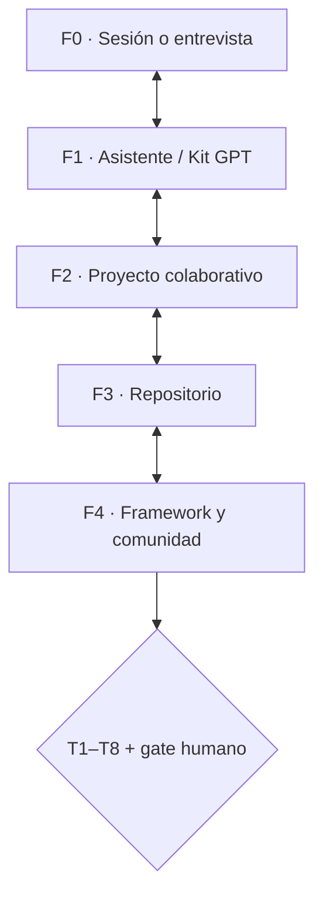

# PIEF · Primer Informe de Evaluación Fractal del Framework v5.3.0

*Conectar escalas sin borrar procedencia, identidad ni diferencia.*

**Fecha de corte:** 21 de octubre de 2026. **Objeto:** Framework Genérico v5.3.0 como sistema sociotécnico-transdisciplinario evolutivo, no solamente app ni repositorio. **Estado:** **APROBADO PARA PILOTO EXPERIMENTAL · AHE 2026-10-21; validaciones empíricas y TSR independientes siguen pendientes.** La aprobación autoriza este producto documental como piloto, no demuestra impacto pedagógico ni validación externa.

**Cómo leer:** [F] hecho respaldado por el expediente consultado; [I] interpretación editorial; [H] hipótesis; [P] propuesta; [NV] no verificado en este corte. Un registro GitHub es evidencia documental de una operación, no validación pedagógica o epistemológica independiente.

> **Límite editorial:** este informe no reproduce ni enlaza la ponencia sometida a arbitraje. Solo utiliza fuentes públicas autorizadas y registros históricos del Framework.

## Portada, lectura humana y mapa

**Unidad primaria:** F4, Framework v5.3.0 y comunidad incipiente. **Dictamen aprobado para piloto [I]:** las relaciones de la arquitectura fractal están **documentadas y parcialmente instrumentalizadas**; la TSR semántica entre escalas **no está validada**. El alcance sigue siendo lectura documental.

*Figura PIEF-1. Hipótesis operacional de relaciones F0–F4. Texto alternativo: cinco escalas vinculadas en ambos sentidos y sometidas a ocho invariantes y decisión humana; las flechas no acreditan transferencia ya ejecutada.*

## 1. Identidad y escala primaria

**[F]** El Framework define estructuras y mecanismos de mediación, memoria, conocimiento y gobernanza. Las escalas son una forma de evaluar la continuidad entre una intervención situada y un sistema mayor, no cinco niveles rígidos de madurez ni cinco obligaciones de producir software. **[I]** PIEF debe mostrar dónde se pierde significado al pasar de F0 a F4.

## 2. Cartografía F0–F4 y satélites

| Escala | Objeto y producto asociado | Evidencia disponible | Límite |
|---|---|---|---|
| F0 | Sesión/entrevista; protocolo y bitácora | [F] Plan PIEF y método satélite identificados | [NV] Receptor de sesión de esta ronda no evaluado. |
| F1 | Kit GPT, edición autónoma y guía | [F] Kit GPT 2.0.0-rc.1 mencionado en pilotos | [NV] Portabilidad semántica multicaso no demostrada. |
| F2 | Proyecto colaborativo situado; IEISP propio | [F] Casos IA en Acción y otras implementaciones documentadas | Debe conservar identidad local y consentimiento. |
| F3 | Repositorio del proyecto | [F] Cuatro repositorios públicos y READMEs diferenciados | Coincidencia F2/F3 requiere prueba de identidad, no inferencia. |
| F4 | Framework y comunidad en construcción | [F] Release v5.3.0, norma y portal de tríada | Infraestructura pública no prueba comunidad consolidada. |

## 3. Relaciones y contratos espejo

**Contrato mínimo:** identidad del objeto y corte; ruta exacta y versión/commit; estado de evidencia; responsable y autoridad; permisos; fuente/receptor; transformación; vínculo inverso; comprobación de retorno y discrepancias. **[F]** El piloto PIEF v0.5.3 y el Plan aprobado del 19-X definen estas obligaciones. **[NV]** No consta, para este informe, un ciclo completo multicaso con dos receptores humanos independientes.

Las cuatro colaboraciones **EME, IA en Acción, RIB-EG-IA y EugenIA/BIVA** representan situaciones heterogéneas. Sus READMEs y el piloto anterior describen alcances distintos, algunos de integración parcial. Ninguno se usa aquí como demostración general de N3/N4 ni de comunidad de práctica. NotebookLM y el asistente cuantitativo no son satélites integrados en esta evaluación por decisión histórica humana.

## 4. Invariantes TSR T1–T8

| Invariante | Situación de evidencia en corte | Reserva/deuda |
|---|---|---|
| T1 Identidad y corte | [F] Contrato definido y versiones históricas fijadas en registro | Comprobar identidad receptor/proyecto en cada caso. |
| T2 Procedencia | [F] Rutas, commits y fuentes consultables | Validar correspondencia Local_First ↔ remoto. |
| T3 Autoridad | [F] Gates G-FW53-EXEC-01, G-REL53 y PR #18 diferenciados | Aprobación de cada instancia situada aún pendiente. |
| T4 Epistemología | [F] Taxonomía [F/H/I/P/NV] y regla de contraste | Equivalencia semántica interinstrumental no probada. |
| T5 Deuda | [F] 21 clases prospectivas FD/AR/ME/TE/GO | Desduplicación y saldos auditados pendientes. |
| T6 Relaciones | [F] Protocolos de enlace espejo y cartografía F0–F4 | Falta ejemplar completo y verificado con retorno. |
| T7 Continuidad | [F] Recuperación técnica de ZIP por segundo runner | No acredita reconstrucción humana del significado. |
| T8 Autonomía | [F] Diseño Local_First y entrega técnica independiente | Cotejo material privado, permisos y límites aún abiertos. |

**[I] Balance:** componentes **especificados** y algunos ensayos **técnicos**; la TSR semántica F0–F4 y entre cuatro casos está **no validada en este corte**. No saltar de «especificado» a «transferido» por existir un ZIP, una guía o un commit.

## 5. Contrastes y casos negativos

**[F]** Los cuatro proyectos no comparten automáticamente objetivos, madurez, métodos ni custodia. **[I]** La diversidad es condición de contraste, pero también riesgo de homologación aparente. **[NV]** No se aportaron resultados independientes que permitan distinguir una discrepancia de interpretación de una pérdida real de significado entre receptores. El protocolo de cotejo Local_First admite estados MATCH/DIVERGENT/LOCAL_ONLY/REMOTE_ONLY/UNKNOWN/EXCLUDED: esa taxonomía permite reportar ausencias sin inventar correspondencias.

## 6. Dictamen, límite y gate

**Dictamen aprobado para piloto [I]:** **APTO COMO CARTOGRAFÍA Y EVALUACIÓN DOCUMENTAL PRELIMINAR; NO APTO PARA DECLARAR TSR GLOBAL VALIDADA.**

**Gate humano de este PIEF:** **APROBADO PARA PILOTO EXPERIMENTAL (AHE 2026-10-21), sin declarar TSR validada.** **Acción siguiente [P]:** escoger un vínculo F2↔F3 con permiso, fijar dos instantáneas, realizar transferencia, reconstrucción por receptor y contra-retorno independiente; evaluar T1–T8 con pérdidas y decisiones registradas. Después, examinar otros enlaces y no generalizar desde un caso.

## 7. Fuentes, continuidad y transparencia

## Fuentes y transparencia de IA

Este informe fue estructurado y redactado con ayuda de ChatGPT de OpenAI a partir de documentos del repositorio y el expediente histórico compartido. La IA no realizó observaciones presenciales, ensayos de usuario ni validaciones científicas externas. La AHE humana aprobó el uso documental de piloto; los autores conservan la responsabilidad de corroborar fuentes y autorizar cualquier publicación académica o validación externa. No se incluyeron datos privados del cartapacio Local_First.

**Fuentes documentales principales:**
- [canon](https://github.com/ricardojuanmorales/framework-proyecto-generico-ia-1/blob/main/02_ARQUITECTURA_CONCEPTUAL/Arquitecturas_Referencia/2026-10-08_Arquitectura_Conceptual_Integrada_Framework_Canon_v1_0.md)
- [release](https://github.com/ricardojuanmorales/framework-proyecto-generico-ia-1/releases/tag/v5.3.0)
- [cierre](https://github.com/ricardojuanmorales/framework-proyecto-generico-ia-1/blob/main/18_DOCUMENTACION_ACTIVA/Cierres_Reportes/Cierres_Sesion/2026-10-20_Cierre_Fuerte_PostRelease_Framework_V5_3_0.md)
- [deuda](https://github.com/ricardojuanmorales/framework-proyecto-generico-ia-1/blob/main/20_MANTENIMIENTO_Y_EVOLUCION/Deuda_Tecnica/2026-10-20_Deuda_Sistemica_FW53_v0.5.3.md)
- [piloto_ieisp](https://github.com/ricardojuanmorales/framework-proyecto-generico-ia-1/blob/main/07_PLANTILLAS_Y_MODELOS/Plantillas_Evaluacion/Framework_v0.5.3/IEISP_Framework_V0.5.3.md)
- [piloto_pief](https://github.com/ricardojuanmorales/framework-proyecto-generico-ia-1/blob/main/07_PLANTILLAS_Y_MODELOS/Plantillas_Evaluacion/Framework_v0.5.3/PIEF_Framework_V0.5.3.md)
- [gate](https://github.com/ricardojuanmorales/framework-proyecto-generico-ia-1/blob/main/18_DOCUMENTACION_ACTIVA/Cierres_Reportes/Reportes_Evaluacion/2026-10-21_Registro_Adopcion_Triada_Documental_v1_0_CANDIDATO.md)

**Registro de autorización situada:** Aprobación Humana Expedita expresa del 21-X-2026: «Marcar como Aprobado para Piloto Experimental». No se aprueban por inferencia resultados que el informe identifica como no verificados.

**Acta de la aplicación:** [AHE y registro de publicación](ACTA_AHE_TRÍADA_v5_3_0_2026-10-21.md).

**Control de versiones:** el corte de los pilotos IEISP y PIEF v0.5.3 (20-X-2026) precede a la publicación estable v5.3.0. Se usa como antecedente y no se reescribe su dictamen histórico. Los informes presentes son primeras *instancias aprobadas para piloto experimental* de modelos genéricos v1.0, no sustituyen fuentes ni autorizan TSR automática.
